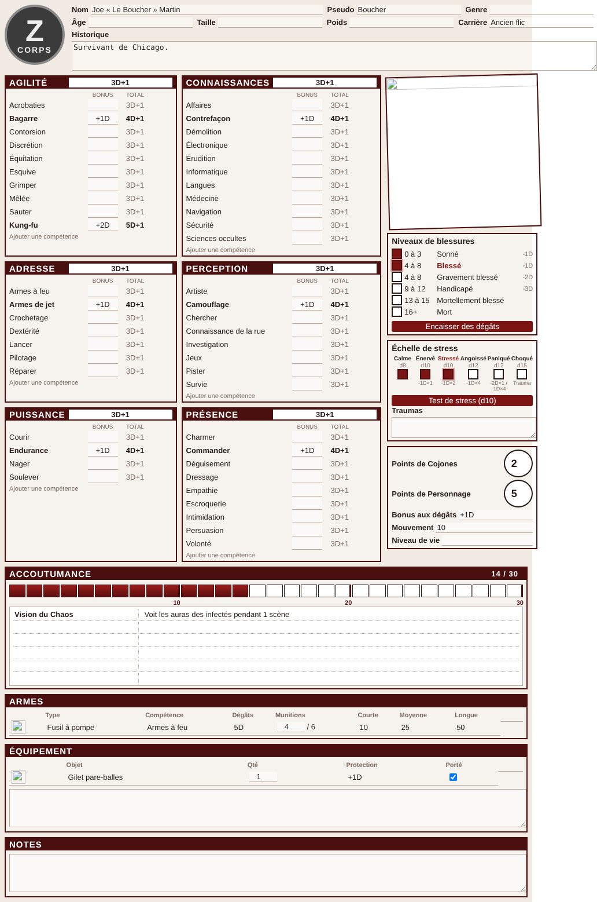

# Z-Corps pour Foundry VTT (non officiel)

Système Foundry VTT **v13** pour Z-Corps, écrit avec les API actuelles (DataModels, ApplicationV2).



## Installation

**Manuelle (recommandée)** : copier le contenu du dépôt dans
`Data/systems/zcorps-vtt/` (le dossier doit s'appeler exactement `zcorps-vtt`
et contenir `system.json`), puis relancer Foundry.

**Par manifeste** (si le dépôt est public) : *Installer un système* →
`https://raw.githubusercontent.com/luminume/test/claude/busy-allen-wb750t/system.json`

## Contenu

- **Personnage** : identité, 6 attributs et toutes les compétences de la fiche officielle,
  compétences supplémentaires par attribut, blessures, échelle de stress, Cojones,
  points de personnage, bonus aux dégâts, mouvement, niveau de vie, équipement.
- **Accoutumance** : jauge de 0 à 30 (clic sur une case, ou −/+) avec paliers à 10, 20 et 30.
  Franchir un palier envoie un message dans le chat. Sous la jauge, une case sans titre
  avec 6 lignes « pouvoir / effet ».
- **PNJ / Zombie** : fiche simplifiée (attributs, compétences libres, blessures, armes).
- **Objets** : arme (compétence, dégâts, munitions, portées), équipement (protection),
  compétence.

## Portraits, banque d'objets, pouvoirs occultes

- **Portrait** : clic sur l'image pour la changer (le jeton suit s'il utilisait l'ancienne image).
  Le bouton <i>écran</i> en bas du portrait l'affiche en grand chez tous les joueurs connectés.
- **Banque d'objets** (loupe dans les blocs Armes et Équipement) : armes, protections, matériel et
  véhicules du livre (p. 67-76), recherche par nom, catégorie ou effet, bouton « + » pour ajouter
  au personnage. Les objets créés par le MJ dans l'onglet Objets du monde y apparaissent aussi
  (bouton « Créer »). Également disponible dans la compendie « Équipement Z-Corps ».
- **Pouvoirs occultes** (MJ uniquement, bouton dans la case des pouvoirs) : les 30 pouvoirs de la
  campagne, rangés par seuil, étiquetés « Campagne » + personnage + PJ/PNJ, avec recherche.
  Cocher = ajouter au personnage, décocher = retirer. Sur la fiche, un pouvoir reste caché au joueur
  tant que le MJ ne l'a pas révélé (icône œil). Compendie « Pouvoirs occultes (MJ) », invisible aux joueurs.
- Données sources : `tools/data/` ; après modification, `npm run build:packs` régénère les compendiums.

## Règles appliquées (livre de base, édition révisée)

- **Dé Joker** sur tous les jets (p. 25) : sur un 6 il explose. Sur un 1 au premier jet,
  c'est un échec critique : la carte donne les deux options du MJ (retirer le dé le plus haut,
  ou garder le total avec une complication).
- **Réussite** si le total *dépasse* la difficulté ; l'égalité est signalée à part (p. 37).
- **Compétences** (p. 22) : la case à cocher indique les compétences sélectionnées à la création.
  Non sélectionnée = Caractéristique -1D ; sélectionnée = Caractéristique + bonus.
- **Points de personnage** (p. 26) : +1D par point, dont un Joker qui explose mais sans
  échec critique ; maximum par jet réglable par le MJ. Utilisables aussi sur les dégâts et la résistance.
- **Cojones** (p. 26) : 1 par test, double dés et tiers ; ou bouton « Relancer » sur un test raté.
  Jamais cumulés avec les points de personnage.
- **Blessures** (p. 63) : résistance = Puissance + protection portée. Résistance ≥ dégâts : rien.
  Marge 1-3 Sonné, 4-8 Blessé (Gravement blessé si déjà Blessé), 9-12 Handicapé,
  13-15 Mortellement blessé, 16+ Mort. Un coup inférieur au niveau actuel fait monter d'un niveau.
  Malus -1D / -1D / -2D / -3D sur les jets de Compétence et de Caractéristique uniquement.
- **Bonus aux dégâts** et **Déplacement** calculés automatiquement (p. 22-23), avec saisie possible pour les remplacer.
  Une arme dont les dégâts commencent par « + » s'ajoute au bonus aux dégâts (p. 57).
- **Progression** (p. 23 et 26) : bouton « Progression » sous les points de personnage, puis
  <i>▲</i> à côté d'une Caractéristique ou d'une compétence pour gagner +1 tiers. Coût actuel
  (barème OpenD6, le chapitre « Récompenser les joueurs » n'étant pas dans les extraits) :
  chiffre devant le D de la valeur actuelle pour une compétence, ×10 pour une Caractéristique.
  Une compétence non sélectionnée passe de Caractéristique -1D à -1D+1 et devient sélectionnée.
  Réglable dans `ADVANCEMENT` (`module/config.mjs`). Chaque achat est noté dans le chat.
- **Initiative** : Test d'Agilité avec Joker ; une action par tranche de 10 points (p. 28).
- **Départ** : 3D par Caractéristique (18D à répartir), 5 points de personnage, 1 point de Cojones.

Maj+clic sur un jet le lance sans fenêtre d'options.

## Pas encore couvert

- **Échelle de stress** : le chapitre « Stress et Folies » (p. 196) n'était pas dans les extraits fournis.
  La fiche affiche les niveaux et lance le dé du niveau actuel, sans interprétation.
- Options de combat (visée, rafales, couverture, localisation), coup mortel, armes assommantes,
  guérison : à appliquer par le MJ via les modificateurs de la fenêtre de jet.
- L'accoutumance et les pouvoirs occultes sont un ajout maison : aucun effet automatique.

## Développement

```bash
npm install
npm test   # règles, codes de dés, rendu des gabarits
```
